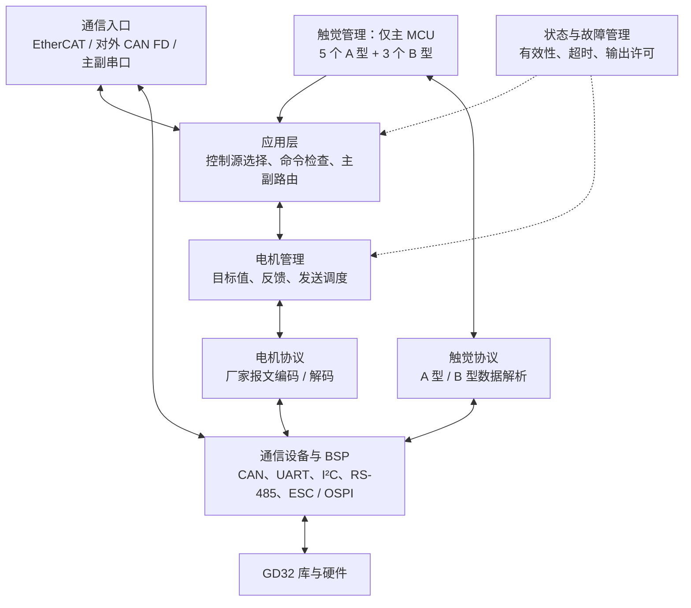
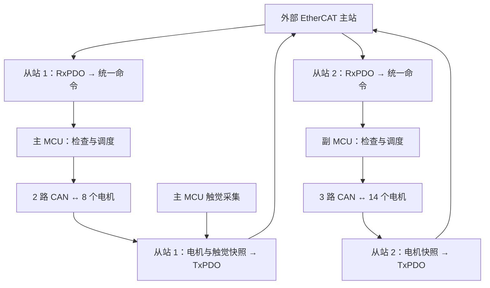
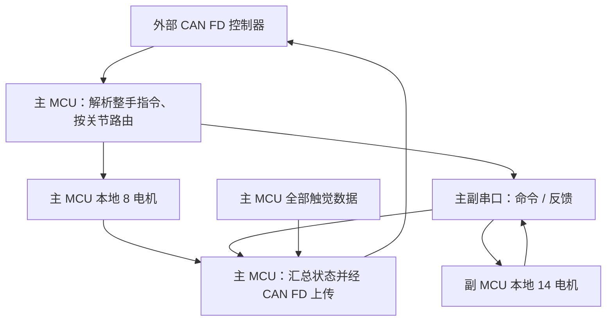

# 22 自由度灵巧手嵌入式软件架构（EtherCAT 版）

设计草案，更新于 2026-11-05。依据双 GD32H75EYMJ7 硬件架构编写；下文为拟采用的软件结构，尚未实现。

## 1. 设计思路

**同一套业务代码，按主、副 MCU 角色配置资源；EtherCAT、CAN FD 和主副串口统一转换为电机控制命令。**

- 主 MCU：管理食指、中指的 8 个电机，采集 5 个 I²C 和 3 个 RS-485 触觉传感器。
- 副 MCU：管理拇指、无名指、小指的 14 个电机。
- EtherCAT 模式：两个独立从站各自接收指令、上传本地反馈。
- CAN FD 模式：主 MCU 接收整手指令，经串口分发副 MCU 的部分，再汇总反馈上传。
- 第一版建议由上位机负责轨迹规划，MCU 负责指令检查、分发、反馈和故障管理；电机内部闭环由驱动器完成。

运行方式暂建议沿用 **裸机主循环 + 中断 / DMA + 非阻塞调度**。主副共用源码，建立两个编译目标；是否采用 RTOS、控制周期及电机协议待确认。

## 2. 软件分层



业务模块不直接拼厂家报文或操作外设寄存器。协议模块只负责编解码；通信设备模块负责收发、忙闲和硬件错误。配置表统一保存关节与硬件的对应关系。

## 3. 主、副 MCU 分工

| 功能 | 主 MCU | 副 MCU |
| --- | --- | --- |
| 本地电机 | ID 6～13，共 8 个 | ID 1～5、14～22，共 14 个 |
| 手指 CAN | CAN0：食指；CAN1：中指 | CAN0：拇指；CAN1：无名指；CAN2：小指 |
| 对外 CAN FD | CAN2，整手命令入口与反馈出口 | 无 |
| EtherCAT | 从站 1，本地电机及全部触觉数据 | 从站 2，本地电机数据 |
| 主副串口 | 分发副 MCU 指令，接收其反馈 | 接收主 MCU 指令，返回本地反馈 |
| 触觉采集 | I²C × 1、专用 UART + RS-485 × 1 | 无 |
| 保护 | 管理本地输出及上行、串口异常 | 独立检测指令超时并管理本地输出 |

主副串口与触觉串口独立。EtherCAT 模式下，副 MCU 的周期电机指令直接来自自己的从站，不经主 MCU 转发。

## 4. 两种模式的数据流

### 4.1 EtherCAT 模式



RxPDO 表示从站接收的过程数据，TxPDO 表示从站发送的过程数据。

- **周期数据**：电机目标、使能状态、反馈及触觉数据；具体字段和长度待协议确定。
- **非周期参数**：通过 CoE / SDO 处理参数读写，慢操作异步完成，不占用周期回调等待电机。
- 两个角色分别定义对应 PDO 和 ESI 配置；主站按整手 ID 合并两从站反馈。

现有 SSC 支持 DC 配置，拟优先评估 DC / Sync0 同步；尚不能据此承诺同步精度。EtherCAT 周期同步与电机实际执行同步需分别验证。

### 4.2 CAN FD 模式



主副串口需定义帧长度、消息类型、会话 / 序号、CRC、心跳和超时。分帧的整手命令须收齐并校验后再提交；丢帧不能产生半套有效指令。CAN FD 上行反馈按数据量分帧，并保留批次和有效性标识。

两种外部接口只允许一个控制源生效。第一版建议在停机状态选择模式，清理旧命令并重新建立使能条件；不因单个报文到达而自动切换模式。

## 5. 主流程与调度

### 5.1 初始化与调用关系

以下只展示关键调用关系；除 SSC 现有入口外，模块名为设计名称，不是已存在的函数。

```text
main()
├─ 初始化时钟、MPU / Cache、外设与通信缓冲
├─ 读取主副角色、关节映射和控制模式
├─ 初始化电机管理、状态管理；主 MCU 初始化触觉
├─ EtherCAT 模式：HW_Init() → MainInit()
└─ 主循环
   ├─ 通信处理：SSC MainLoop() 或 CAN FD / 主副串口处理
   ├─ 状态检查：指令有效期、设备在线和输出许可
   ├─ 控制调度：提交完整命令，推进本地 CAN 发送
   ├─ 反馈处理：解析电机回复并更新本地状态
   ├─ 触觉调度：主 MCU 按采样周期推进 I²C / RS-485
   └─ 状态发布：生成一致快照，供当前通信模式上传

中断 / DMA：收帧、记录时间、更新完成标志或投递事件
            → 主循环解析和处理业务
```

### 5.2 EtherCAT 回调边界

| 入口 | 拟定职责 |
| --- | --- |
| `APPL_OutputMapping()` | 拷贝 RxPDO 到待处理缓冲，不直接执行电机发送 |
| `APPL_Application()` | 提交本周期命令快照、记录周期事件；不阻塞等待回复 |
| `APPL_InputMapping()` | 拷贝已发布的反馈快照到 TxPDO，不现场读取传感器 |
| CAN / UART / I²C 中断 | 收发搬运和事件通知，不执行整手业务 |

SSC 的应用回调可能在中断上下文执行，缓冲交接应使用双缓冲和短临界区，避免半更新数据。拟采用“同步事件触发、主循环有界处理”的方案；若实测调度延迟不能满足指标，再调整实时执行位置。

### 5.3 周期安排

| 工作 | 调度方式 |
| --- | --- |
| EtherCAT 电机命令 | 随主站约定的周期 / 同步事件提交，具体周期待定 |
| CAN FD 电机命令 | 收到完整有效请求后提交，按本地可配置节拍调度 |
| CAN 收发与反馈 | 持续推进，独立管理每路总线的忙闲与超时 |
| A / B 型触觉 | 独立采样周期，上传最新有效结果，不阻塞电机控制 |
| 通信失联与故障检查 | 基于单调时钟定时检查，不依赖新命令到达或回调次数 |

每轮处理限定帧数或时间预算；各路电机总线独立推进，一路无回复不阻塞其他总线。查询、自检和参数设置均采用非阻塞状态推进，替换现有启动长延时和同步等待。

## 6. 命令、反馈与故障管理

统一维护三类数据：

| 数据 | 内容与归属 |
| --- | --- |
| 关节映射 | 整手 ID → 主副角色 → CAN 通道 → 电机地址；两颗 MCU 共用配置定义 |
| 电机目标与反馈 | 每颗 MCU 管理自己的 8 / 14 个电机；主 MCU 在 CAN FD 模式额外缓存副 MCU 反馈 |
| 触觉与系统状态 | 主 MCU 管理 8 个传感器数据；各 MCU 独立维护故障、在线和数据有效性 |

目标指令与反馈状态分开保存。反馈带时间或序号及有效性；发送成功不表示电机已执行完成，通信中断后的旧值不能继续标记为有效。

**周期设定值**采用最新完整目标覆盖旧目标；**使能、回零、参数设置及相对位移等离散动作**通过有界队列处理并去重。停止请求优先，不能排在普通动作队尾；队满须明确拒绝或报告，不能静默丢失操作。

建议状态为 **初始化 → 就绪 → 运行 → 故障**。启动默认禁止运动，只有控制源有效且使能条件满足才允许下发运动指令。失联或严重故障时撤销运动许可，执行约定的停止 / 失能策略；故障解除后需显式恢复，不自动重新使能。

在 EtherCAT 模式，主站负责跨从站的整手停机协调，两颗 MCU 各自执行本地保护；CAN FD 模式由主 MCU 发起跨板协调，副 MCU 同时独立监测串口超时。通信断开时无法保证停止报文送达，需结合电机驱动器自身的通信超时功能。具体停机方式及单电机故障是否联动整手待确认。

## 7. 建议文件结构

同名 `.c/.h` 合并展示。按模块描述职责，不逐项罗列函数。

```text
User/
├─ main.c                       启动与主循环入口
├─ App/
│  ├─ app_main.c/.h             初始化、模式管理与调度
│  ├─ hand_controller.c/.h      命令检查、主副路由
│  └─ safety_manager.c/.h       输出许可、超时与故障
├─ Device/
│  ├─ motor_manager.c/.h        本地电机目标、反馈及发送调度
│  ├─ tactile_manager.c/.h      A / B 型传感器采集与有效性
│  ├─ can_bus.c/.h              多路 CAN 非阻塞收发
│  └─ serial_link.c/.h          主副串口收发及链路状态
├─ Protocol/
│  ├─ ethercat_app.c/.h         SSC 回调、PDO 与统一命令转换
│  ├─ canfd_protocol.c/.h       对外 CAN FD 编解码
│  ├─ inter_mcu_protocol.c/.h   主副串口帧编解码
│  ├─ motor_protocol.c/.h      电机厂家协议适配
│  └─ tactile_protocol.c/.h    两类触觉数据解析
├─ Config/
│  ├─ board_config.h           主副角色、模式与外设分配
│  ├─ hand_config.c/.h         22 关节映射、方向与限位
│  └─ hand_types.h             统一命令、反馈及状态类型
├─ BSP/                        CAN、UART、I²C、RS-485 等硬件适配
└─ ethercat/                   保留 SSC 栈、对象字典和相关配置

Firmware/                      GD32 库与 CMSIS
ESI/                           与主、副角色匹配的从站描述
MDK-ARM/                       主、副两个编译目标（建议）
```

沿用当前 GD32 标准外设库和 ESC 驱动基础，不照搬参考项目的 STM32 HAL、UART / MUX 电机链路。现有 `control.c` 的职责逐步拆分到电机管理、协议和故障模块；旧的“每路 8 电机、共 24 电机”计算改为显式映射。

## 8. 待确认的设计输入

| 问题 | 当前草案处理 |
| --- | --- |
| 电机厂家 / 型号、CAN 协议、控制与反馈能力 | 预留厂家协议适配，不假定旧工程协议可直接复用 |
| 裸机或 RTOS、主副固件组织 | 建议裸机 + 共用代码 + 两个编译目标 |
| 控制周期、跨板同步误差、触觉采样率 | 参数可配置，待带宽与时序验证后定值 |
| 上位机与 MCU 的控制边界 | 建议上位机规划轨迹，MCU 分发与管理；是否需要本地插补 / 力控待确认 |
| 失联停机方式与故障联动范围 | 先定义输出许可和超时机制，具体电机动作待确认 |
| 对外 CAN FD 协议兼容要求 | 不默认与参考工程兼容；待确定是否沿用原命令及单位 |
