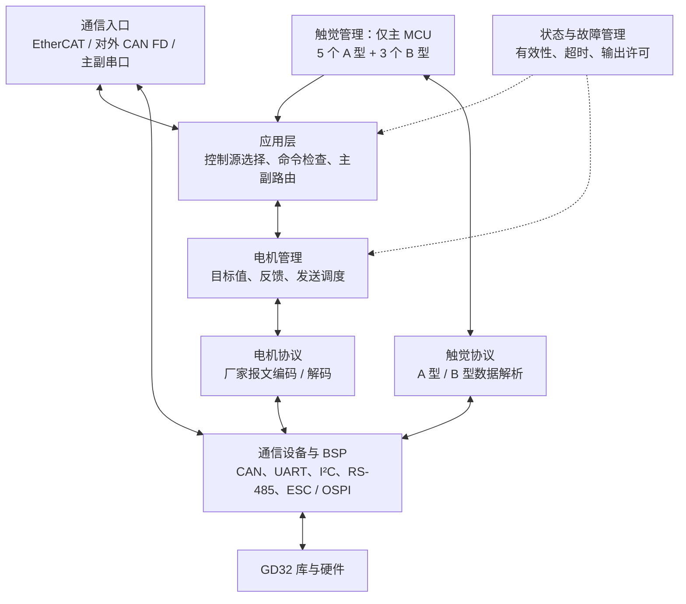
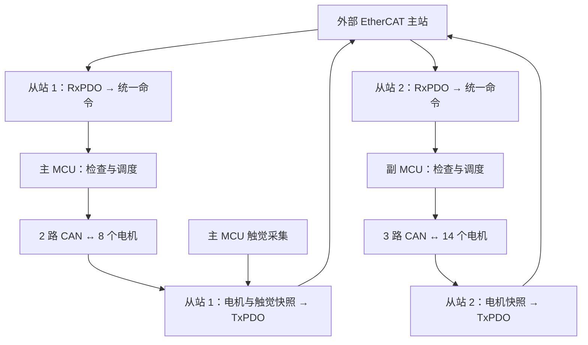
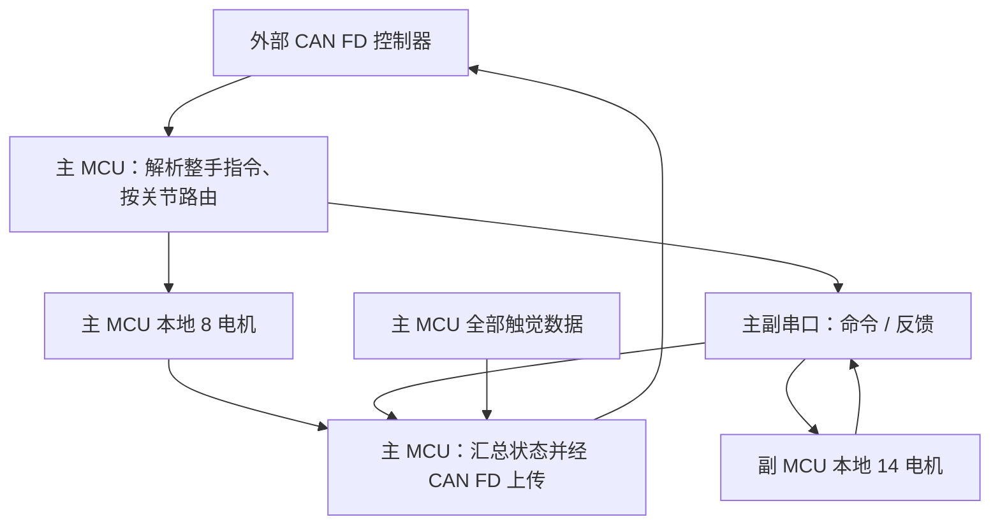

# 22 自由度灵巧手嵌入式软件架构（EtherCAT 版）
设计草案，更新于 2026-11-06。依据双 GD32H75EYMJ7 硬件架构编写；下文为拟采用的软件结构，尚未实现。

## 1. 设计思路

**同一套业务代码，按主、副 MCU 角色配置资源；EtherCAT、CAN FD 和主副串口统一转换为电机控制命令。**

- 主 MCU：管理食指、中指的 8 个电机，采集 5 个 I²C 和 3 个 RS-485 触觉传感器。
- 副 MCU：管理拇指、无名指、小指的 14 个电机。
- EtherCAT 模式：两个独立从站各自接收指令、上传本地反馈。
- CAN FD 模式：主 MCU 接收整手指令，经串口分发副 MCU 的部分，再汇总反馈上传。
- 第一版建议由上位机负责轨迹规划，MCU 负责指令检查、分发、反馈和故障管理；电机内部闭环由驱动器完成。

已确定采用 **裸机主循环 + 中断 / DMA + 非阻塞调度**，电机使用 **ZJ CAN FD 协议**，EtherCAT 通信频率为 **1000 Hz（1 ms）**。两颗 MCU 烧录同一份通用固件，启动时读取硬件角色引脚并锁定角色。

## 2. 软件分层



业务模块不直接拼厂家报文或操作外设寄存器。软件分层表示职责边界，不要求每层都单独建文件，外设寄存器操作仍由 BSP 完成。

## 3. 主、副 MCU 分工

| 功能 | 主 MCU | 副 MCU |
| --- | --- | --- |
| 本地电机 | ID 6～13，共 8 个 | ID 1～5、14～22，共 14 个 |
| 手指 CAN | CAN0：食指；CAN1：中指 | CAN0：拇指；CAN1：无名指；CAN2：小指 |
| 对外 CAN FD | CAN2，整手命令入口与反馈出口 | 无 |
| EtherCAT | 从站 1，本地电机及全部触觉数据 | 从站 2，本地电机数据 |
| 主副串口 | 分发副 MCU 指令，接收其反馈 | 接收主 MCU 指令，返回本地反馈 |
| 触觉采集 | I²C × 1、专用 UART + RS-485 × 1 | 无 |
| 保护 | 管理本地输出及上行、串口异常 | 独立检测指令超时并管理本地输出 |

主副串口与触觉串口独立。EtherCAT 模式下，副 MCU 的周期电机指令直接来自自己的从站，不经主 MCU 转发。

## 4. 两种模式的数据流

### 4.1 EtherCAT 模式



RxPDO 表示从站接收的过程数据，TxPDO 表示从站发送的过程数据。

- **周期数据**：电机目标、使能状态、反馈及触觉数据；具体字段和长度待协议确定。
- **非周期参数**：通过 CoE / SDO 处理参数读写，慢操作异步完成，不占用周期回调等待电机。
- 两个角色分别定义对应 PDO 和 ESI 配置；主站按整手 ID 合并两从站反馈。

EtherCAT 每 1 ms 交换一次过程数据。建议以 DC / Sync0 对齐两颗 MCU 的调度节拍，再分别推进五路电机 CAN FD；具体同步方式与允许误差待确认。当前 ZJ 协议未定义统一执行时间或同步触发命令，因此不能由 EtherCAT 的 1 ms 周期推定 22 个电机同时执行。

### 4.2 CAN FD 模式



主副串口需定义帧长度、消息类型、会话 / 序号、CRC、心跳和超时。分帧的整手命令须收齐并校验后再提交；丢帧不能产生半套有效指令。CAN FD 上行反馈按数据量分帧，并保留批次和有效性标识。

EtherCAT 与 CAN FD 两个入口常开，不设互斥模式：命令走同一条管道写入同一份整手数据。

## 5. 主流程与调度

### 5.1 初始化与调用关系

以下只展示关键调用关系；除 SSC 现有入口外，模块名为设计名称，不是已存在的函数。

```text
main()
├─ 初始化时钟、MPU / Cache（DMA 缓冲区置于非缓存区）和角色识别 GPIO，保持禁止运动
├─ 等待电平稳定、连续采样并锁定角色；失败则进入配置故障
├─ 根据锁定角色加载映射，初始化外设、通信缓冲与控制模式
├─ 初始化电机管理、状态管理；主 MCU 初始化触觉
├─ EtherCAT 模式：HW_Init() → MainInit()
└─ 主循环
   ├─ 通信处理：SSC MainLoop() 或 CAN FD / 主副串口处理
   ├─ 状态检查：指令有效期、设备在线和输出许可
   ├─ 控制调度：提交完整命令，推进本地 CAN 发送
   ├─ 反馈处理：解析电机回复并更新本地状态
   ├─ 触觉调度：主 MCU 按采样周期推进 I²C / RS-485
   └─ 状态发布：生成一致快照，供当前通信模式上传

中断 / DMA：收帧、记录时间、更新完成标志或投递事件
            → 主循环解析和处理业务
```

### 5.2 EtherCAT 回调边界

沿用现有 `User/ethercat/GDESC_IO_motor.c` 实现下列应用回调。当前 `APPL_OutputMapping()` 拷贝数据后直接调用 `motor_ctl_task()`，`APPL_Application()` 尚无业务逻辑；后续按下表调整，电机发送由非阻塞调度推进。

| 入口 | 拟定职责 |
| --- | --- |
| `APPL_OutputMapping()` | 拷贝 RxPDO 到待处理缓冲，不直接执行电机发送 |
| `APPL_Application()` | 提交本周期命令快照、记录周期事件；不阻塞等待回复 |
| `APPL_InputMapping()` | 拷贝已发布的反馈快照到 TxPDO，不现场读取传感器 |
| `APPL_GenerateMapping()` | 根据对象字典计算 PDO 长度，与当前锁定角色、EEPROM 和 ESI 配置一致 |
| `APPL_StartOutputHandler()` / `APPL_StopOutputHandler()` | 更新 EtherCAT 输出有效条件；退出 OP 时撤销该控制源的运动许可，不直接阻塞发送电机报文 |
| CAN / UART / I²C 中断 | 收发搬运和事件通知，不执行整手业务 |

SSC 的应用回调可能在中断上下文执行，缓冲交接应使用双缓冲和短临界区，避免半更新数据。拟采用“同步事件触发、主循环有界处理”的方案；若实测调度延迟不能满足指标，再调整实时执行位置。

### 5.3 周期安排

| 工作 | 调度方式 |
| --- | --- |
| EtherCAT 过程数据 | 已定 1000 Hz，每 1 ms 交换命令与反馈快照 |
| 电机目标与反馈 | 建议每 1 ms 调度一轮目标；实际下发与反馈刷新频率需按 ZJ 协议带宽验证 |
| CAN FD 电机命令 | 收到完整有效请求后提交，按本地可配置节拍调度 |
| CAN 收发与反馈 | 持续推进，独立管理每路总线的忙闲与超时 |
| A / B 型触觉 | 独立低频采样；EtherCAT 每 1 ms 上报最近一次有效值及其采样序号 / 数据年龄 |
| 通信失联与故障检查 | 基于单调时钟定时检查，不依赖新命令到达或回调次数 |

每轮处理限定帧数或时间预算；各路电机总线独立推进，一路无回复不阻塞其他总线。查询、自检和参数设置均采用非阻塞状态推进，替换现有启动长延时和同步等待。

### 5.4 低频数据如何接入 1 ms EtherCAT 周期

以 100 Hz 传感器为例：每 10 ms 采样一次，期间 10 个 EtherCAT 周期可以上传同一份采样值。采样序号只在获得新样本时递增，数据年龄随时间增长；超过对应传感器的有效期才标记超时。每个传感器独立记录，不把重复上传当成新的采样。未完成首次采样时标记无效。

电机反馈同样通过缓存快照上报。当前周期读到的反馈不一定对应当前周期刚下发的目标；不得把不同时间获取的位置、速度和电流称为同时采样。

### 5.5 ZJ CAN FD 协议适配要点

参考 [ZJ-关节模组CANFD通信协议.md](电机协议/ZJ-关节模组CANFD通信协议.md)，该协议仍在修订，以下作为当前适配基线。

| 项目 | 当前协议与软件处理 |
| --- | --- |
| 链路 | 11 位标准 ID、CAN FD、BRS；仲裁段 1 Mbit/s、数据段 2 Mbit/s，采样点目标均为 83.3%，需按时钟配置复核 |
| 帧格式 | 普通对象 8 字节、PID 对象 16 字节；小端编码。16 字节对应 DLC 编码 0xA，不把长度与 DLC 混用 |
| 节点映射 | 协议 Node ID 为 0～21，整手逻辑 ID 为 1～22；通过配置表转换，建议 Node ID = 整手 ID − 1，实际烧录地址待确认 |
| 控制 | 使能 / 失能、故障复位；CSP 位置、CSV 速度、CST 电流；切换模式在失能状态执行并读回确认；MIT 暂未实现 |
| 反馈 | 位置、速度、电流、状态和错误码按对象读取；写入应答只说明对象已接受，不代表运动完成 |
| 单位 | 位置示例为度、速度为 RPM、电流为 mA；0x6071 / 0x6077 当前按电流处理，不直接作为 N·m 力矩；符号和范围随修订确认 |
| 应答关联 | 按 CAN 通道、Node ID、TYPE 和 INDEX 匹配；初版建议每节点最多一个待应答事务，异步推进，禁止无界等待 |
| 协议缺口 | 心跳载荷 / 周期、通信超时动作、目标执行时刻未完整定义；超时后同类重试的迟到应答难以区分，不承诺严格逐周期关联 |

一条五电机总线若每周期对每个电机写一个目标并读位置、速度、电流，按每请求一个应答计算，共 **5 ×（2 + 3 × 2）= 40 帧 / 周期**。若要求 1 kHz，就是单总线每秒 40000 帧；必须计算线速占用并测量电机应答延迟，不能只按 8 字节载荷估算。

因此将“1 kHz EtherCAT 交换”与“电机目标下发 / 各类反馈刷新率”分开配置。优先保证目标调度，反馈按带宽分频；如要求全部反馈也达到 1 kHz，需评估增加合并反馈或周期主动上报协议。

## 6. 命令、反馈与故障管理

统一维护三类数据：

| 数据 | 内容与归属 |
| --- | --- |
| 关节映射 | 整手 ID → 主副角色 → CAN 通道 → 电机地址；两颗 MCU 共用配置定义 |
| 电机目标与反馈 | 每颗 MCU 管理自己的 8 / 14 个电机；主 MCU 在 CAN FD 模式额外缓存副 MCU 反馈 |
| 触觉与系统状态 | 主 MCU 管理 8 个传感器数据；各 MCU 独立维护故障、在线和数据有效性 |

目标指令与反馈状态分开保存。反馈带时间或序号及有效性；发送成功不表示电机已执行完成，通信中断后的旧值不能继续标记为有效。

整手数据由 hand_controller 唯一拥有：22 个电机槽按整手 ID 固定布局，含 8 个触觉槽；主 MCU 可有效槽位为 ID 6～13 及全部触觉，副 MCU 为 ID 1～5、14～22。TxPDO、CAN FD 上行与串口反馈只读拷贝该快照。

**周期设定值**采用最新完整目标覆盖旧目标；**使能、模式切换、故障复位及参数设置等离散操作**通过有界队列处理并去重。停止请求优先，不能排在普通动作队尾；队满须明确拒绝或报告，不能静默丢失操作。

建议状态为 **初始化 → 就绪 → 运行 → 故障**。启动默认禁止运动，只有控制源有效且使能条件满足才允许下发运动指令。失联或严重故障时撤销运动许可，执行约定的停止 / 失能策略；故障解除后需显式恢复，不自动重新使能。

在 EtherCAT 模式，主站负责跨从站的整手停机协调，两颗 MCU 各自执行本地保护；CAN FD 模式由主 MCU 发起跨板协调，副 MCU 同时独立监测串口超时后本地广播急停。通信断开时无法保证停止报文送达，需结合电机驱动器自身的通信超时功能。具体停机方式及单电机故障是否联动整手待确认。

## 7. 精简后的文件结构

同名 `.c/.h` 合并展示。下列为目标结构：复用现有 EtherCAT 文件，其余模块在固件适配时逐步整理。

```text
User/
├─ main.c                       启动与主循环入口
├─ App/
│  ├─ app_main.c/.h             角色锁定、初始化与主循环调度
│  ├─ hand_controller.c/.h      命令检查、主副路由、整手数据（唯一所有者）
│  ├─ safety_manager.c/.h       输出许可、超时与故障处理
│  └─ diagnostics.c/.h          周期时序、总线占用与故障计数（暂不实现）
├─ Device/
│  ├─ motor_manager.c/.h        本地电机目标、反馈及发送调度
│  ├─ tactile_manager.c/.h      A / B 型传感器采集、解析与有效性
│  ├─ can_bus.c/.h              多路 CAN 非阻塞收发
│  └─ serial_link.c/.h          主副串口收发、帧编解码、组帧与心跳
├─ Protocol/
│  ├─ canfd_protocol.c/.h       对外 CAN FD 编解码
│  └─ motor_protocol.c/.h       ZJ CAN FD 对象读写、反馈及错误解析
├─ Config/
│  ├─ hand_config.c/.h          角色引脚、外设、通信参数、关节映射与限位
│  └─ hand_types.h             公共角色、命令、反馈及状态类型
├─ BSP/                         GPIO、CAN、UART、I²C、RS-485 硬件适配
└─ ethercat/
   ├─ GDESC_IO_motor.c/.h       复用并适配：应用回调、PDO 与统一数据转换
   ├─ GDESC_IO_motorObjects.h   适配：对象字典与 PDO 定义
   ├─ ecat_def.h               SSC 功能与过程数据容量配置
   └─ 其余 SSC 文件             保留：状态机、同步、CoE / SDO 等协议栈

Firmware/                      GD32 库、ESC 驱动库与 CMSIS
ESI/                           与主、副角色及 EEPROM 匹配的从站描述
MDK-ARM/                       一个通用固件编译目标，主副烧录相同产物
```

沿用当前 GD32 标准外设库和 ESC 驱动基础，不照搬参考项目的 STM32 HAL、UART / MUX 电机链路。现有 `control.c` 的职责逐步拆分到电机管理、协议和故障模块；旧的“每路 8 电机、共 24 电机”计算改为显式映射。

### 通用固件与角色锁定

两颗 MCU 使用相同固件，采用专用 GPIO 识别角色：**0 为主 MCU，1 为副 MCU**。运行时身份记为 `mcu_role`。

```c
typedef enum {
    MCU_ROLE_PRIMARY = 0,   /* 主 MCU，角色引脚为低 */
    MCU_ROLE_SECONDARY = 1  /* 副 MCU，角色引脚为高 */
} mcu_role_t;
```

- `mcu_role` 由启动模块一次赋值，其他模块只读；禁止在循环或中断中按引脚电平重新分配主副功能。只有上电 / 复位才重新识别。
- 通用固件包含两套角色资源配置；启动后选择一套。ESC 使用独立 EEPROM 配置。

## 8. 待确认的设计输入

| 问题 | 当前草案处理 |
| --- | --- |
| 电机控制与反馈范围 | 已定 ZJ CAN FD；首版启用的位置 / 速度 / 电流模式及各字段刷新率待定 |
| 控制周期与同步 | 已定 EtherCAT 1 ms，触觉可低频；电机收发周期、同步方式和容许误差待定 |
| 上位机与 MCU 的控制边界 | 建议上位机规划轨迹，MCU 分发与管理；是否需要本地插补 / 力控待确认 |
| 失联停机方式与故障联动范围 | 先定义输出许可和超时机制，具体电机动作待确认 |
| 对外 CAN FD 协议兼容要求 | 不默认与参考工程兼容；待确定是否沿用原命令及单位 |
