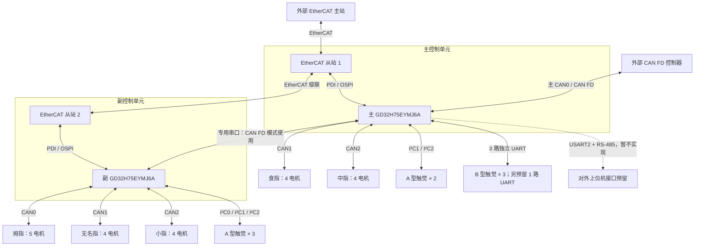

# 21 自由度灵巧手硬件控制架构（EtherCAT 版）

本项目采用 **双 GD32H75EYMJ6A + 五路手指 CAN**，对外支持 **EtherCAT / CAN FD** 两种控制方式。

## 1. 总体方案

- **主 MCU**：控制食指、中指，共 8 个电机；采集 2 个 A 型 I²C 触觉和 3 个 B 型 UART 触觉传感器。
- **副 MCU**：控制拇指、无名指、小指，共 13 个电机；采集 3 个 A 型 I²C 触觉传感器。
- **EtherCAT 模式**：两颗 MCU 分别作为独立从站，由外部主站统一控制。
- **CAN FD 模式**：外部控制器连接主 MCU，主 MCU 通过串口与副 MCU 交换指令和反馈。
- **角色识别**：两颗 MCU 烧录同一固件，专用引脚 PH10 高电平 1 为主、低电平 0 为副；启动时稳定采样并锁定，运行期间不切换。

两颗 MCU 合计 **6 路 CAN**：主 MCU 的 CAN0 用于对外 CAN FD，CAN1 / CAN2 用于手指；副 MCU 的 CAN0 / CAN1 / CAN2 均用于手指。对外上位机 RS-485 为硬件预留，本期暂不实现协议与控制功能。

## 2. 项目硬件信息

| 硬件 | 数量 | 用途 |
| --- | --- | --- |
| GD32H75EYMJ6A | 2 颗 | 主、副 MCU 分别控制两组手指 |
| 角色识别 GPIO | 每颗 MCU 1 个 | PH10：主 MCU 经 R126（10kΩ）上拉为 1，副 MCU 经 R127（10kΩ）下拉为 0 |
| EtherCAT 从站功能单元 | 2 套 | 每颗 MCU 对应一个从站 |
| 手指 CAN 总线 | 5 路 | 每根手指独占一路 |
| 对外 CAN FD | 1 路 | 接入主 MCU，作为整手通信入口 |
| CAN 收发通道 | 6 路 | 主 MCU 3 路、副 MCU 3 路 |
| MCU 间串口 | 1 条双向链路 | CAN FD 模式下主副通信 |
| A 型触觉传感器 | 5 个 | 每个独占 1 路 I²C；主 MCU 2 路、副 MCU 3 路 |
| B 型触觉传感器 | 3 个 | 主 MCU 使用 3 路独立 UART，一路连接一个传感器 |
| B 型触觉 UART 接口 | 4 路 | USART0、USART1、USART5、UART3；使用 3 路，剩余 1 路预留，具体预留通道待确认 |
| 对外 RS-485 收发通道 | 1 路 | 主 MCU USART2 接上位机；硬件预留，本期暂不实现 |
| 电机及驱动器 | 21 套 | 主 MCU 管理 8 套，副 MCU 管理 13 套 |

现有工程通过 OSPI 访问 ESC（EtherCAT 从站控制器）；ESC / PHY 的集成形式及物理连接以芯片资料和原理图为准。

## 3. 主、副 MCU 接口分配

| 接口 | 主 MCU | 副 MCU |
| --- | --- | --- |
| CAN0 | 对外 CAN FD：ECAN0 | 拇指：5 电机，ID 1～5，ECAN3 / CN7 |
| CAN1 | 食指：4 电机，ID 6～9，ECAN1 / CN5 | 无名指：4 电机，ID 14～17，ECAN4 / CN8 |
| CAN2 | 中指：4 电机，ID 10～13，ECAN2 / CN6 | 小指：4 电机，ID 18～21，ECAN5 / CN9 |
| EtherCAT | 从站 1：本地 8 电机 + 2 个 A 型及 3 个 B 型触觉 | 从站 2：本地 13 电机 + 3 个 A 型触觉 |
| MCU 间串口 | UART7：连接副 MCU | UART7：连接主 MCU |
| I²C | I²C1 → CN5、I²C2 → CN6，A 型触觉 × 2 | I²C0 → CN7、I²C1 → CN8、I²C2 → CN9，A 型触觉 × 3 |
| B 型触觉 UART | USART0 / USART1 / USART5 / UART3，使用 3 路、预留 1 路 | — |
| 对外上位机 RS-485 | USART2 + 收发器；本期暂不实现 | — |
| 角色识别引脚 | PH10 / T13，固定高电平 1，网名 MCU0_ID_STRAP | PH10 / T13，固定低电平 0，网名 MCU1_ID_STRAP |

主 MCU 使用 **2 路手指 CAN + 1 路对外 CAN FD**，副 MCU 使用 **3 路手指 CAN**。主副通信 UART7、B 型触觉 UART 和对外 RS-485 的 USART2 相互独立。主 MCU 本期使用 UART7 加 3 路触觉 UART；第四路触觉 UART 和对外 USART2 / RS-485 暂不启用。

电机 ID 沿用整手逻辑编号，不直接等同于 CAN 报文 ID。上表保留原架构的手指分组，将其映射到实际 CAN 外设和连接器；原理图只标注 FINGER1～5，装配线束需按此表核对手指名称。

角色引脚为两颗 MCU 的 PH10（球位 T13），采用外部 10kΩ 上拉 / 下拉，启动时稳定采样并锁定。注意原理图的 MCU0_ID_STRAP / MCU1_ID_STRAP 命名与 MCU1 / MCU2 网络前缀不是同一编号体系，软件以物理芯片和电平映射角色。

## 4. 硬件架构图



图中 CAN 连接均需经过收发器；对外 RS-485 预留接口经过 RS-485 收发器，B 型触觉使用独立 UART 接口。EtherCAT 级联与 MCU 间 UART7 是两条独立链路。

## 5. 两种通信模式

### EtherCAT 模式

```text
外部 EtherCAT 主站
  ├─ 从站 1 / 主 MCU → 食指、中指
  └─ 从站 2 / 副 MCU → 拇指、无名指、小指

反馈：从站 1 上报本地 8 电机、2 个 A 型和 3 个 B 型触觉；
      从站 2 上报本地 13 电机、3 个 A 型触觉。外部主站合并整手数据。
```

主、副 MCU 均为 EtherCAT 从站，周期控制数据由外部主站分别交换。

### CAN FD 模式

```text
外部 CAN FD 控制器 → 主 MCU
                       ├─ 本地 CAN → 食指、中指
                       └─ 串口 → 副 MCU → 拇指、无名指、小指

反馈：副 MCU 经串口回传本地 13 电机和 3 个 A 型触觉；
      主 MCU 合并本地 8 电机、2 个 A 型和 3 个 B 型触觉，汇总整手反馈后上传。
```

同一时刻只由一种对外接口控制运动，模式切换在停机状态完成。

## 6. 待确认事项

- **触觉接口**：5 个 A 型传感器各占独立 I²C 总线，不要求跨总线地址互异；逐路确认上拉、电平、地址和采样速率。3 个 B 型传感器使用独立 UART，确认型号、协议、电平、波特率及四个接口中哪一路预留。
- **触觉辅助 IO**：IO_CN1～5 均接主 MCU PC0～PC4；若作为副 MCU 所采集传感器的数据就绪信号，需明确轮询、跨 MCU 通知或硬件调整方案。
- **硬件参数**：后续确定 ESC / PHY 连接、引脚、通信速率、传感器型号及供电规格。

本文为硬件架构方案，固件适配另行开展。
