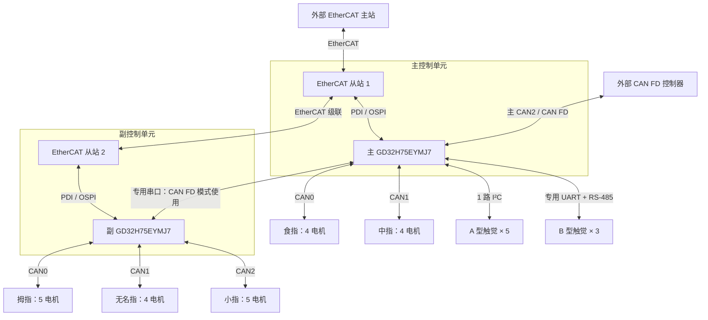

# 22 自由度灵巧手硬件控制架构（EtherCAT 版）

本项目采用 **双 GD32H75EYMJ7 + 五路手指 CAN**，对外支持 **EtherCAT / CAN FD** 两种控制方式。

## 1. 总体方案

- **主 MCU**：控制食指、中指，共 8 个电机；采集全部触觉传感器。
- **副 MCU**：控制拇指、无名指、小指，共 14 个电机。
- **EtherCAT 模式**：两颗 MCU 分别作为独立从站，由外部主站统一控制。
- **CAN FD 模式**：外部控制器连接主 MCU，主 MCU 通过串口与副 MCU 交换指令和反馈。
- **角色识别**：两颗 MCU 烧录同一固件，专用引脚 0 为主、1 为副；启动时稳定采样并锁定，运行期间不切换。

本文暂按**两颗 MCU 合计 6 路 CAN**规划：5 路用于手指，剩余 1 路用于对外 CAN FD。具体外设编号为建议分配。

## 2. 项目硬件信息

| 硬件 | 数量 | 用途 |
| --- | --- | --- |
| GD32H75EYMJ7 | 2 颗 | 主、副 MCU 分别控制两组手指 |
| 角色识别 GPIO | 每颗 MCU 1 个 | 主 MCU 外部下拉为 0，副 MCU 外部上拉为 1 |
| EtherCAT 从站功能单元 | 2 套 | 每颗 MCU 对应一个从站 |
| 手指 CAN 总线 | 5 路 | 每根手指独占一路 |
| 对外 CAN FD | 1 路 | 接入主 MCU，作为整手通信入口 |
| CAN 收发通道 | 6 路 | 主 MCU 3 路、副 MCU 3 路 |
| MCU 间串口 | 1 条双向链路 | CAN FD 模式下主副通信 |
| A 型触觉传感器 | 5 个 | 共用主 MCU 的 1 路 I²C |
| B 型触觉传感器 | 3 个 | 共用主 MCU 的 1 路 RS-485 |
| RS-485 收发通道 | 1 路 | 主 MCU 连接 B 型触觉传感器 |
| 电机及驱动器 | 22 套 | 主 MCU 管理 8 套，副 MCU 管理 14 套 |

现有工程通过 OSPI 访问 ESC（EtherCAT 从站控制器）；ESC / PHY 的集成形式及物理连接以芯片资料和原理图为准。

## 3. 主、副 MCU 接口分配

| 接口 | 主 MCU | 副 MCU |
| --- | --- | --- |
| CAN0 | 食指：4 电机，ID 6～9 | 拇指：5 电机，ID 1～5 |
| CAN1 | 中指：4 电机，ID 10～13 | 无名指：4 电机，ID 14～17 |
| CAN2 | 对外 CAN FD | 小指：5 电机，ID 18～22 |
| EtherCAT | 从站 1：电机反馈 + 全部触觉数据 | 从站 2：电机反馈 |
| MCU 间串口 | 连接副 MCU | 连接主 MCU |
| I²C | A 型触觉 × 5 | — |
| 专用 UART + RS-485 | B 型触觉 × 3 | — |
| 角色识别引脚 | 固定低电平 0 | 固定高电平 1 |

主 MCU 使用 **2 路手指 CAN + 1 路对外 CAN FD**，副 MCU 使用 **3 路手指 CAN**。主副通信串口与 RS-485 触觉串口独立，因此主 MCU 至少需要 2 个 UART / USART。

电机 ID 沿用整手逻辑编号，不直接等同于 CAN 报文 ID。具体引脚在原理图阶段确定。

角色引脚采用明确的外部上拉 / 下拉，保持专用、不悬空，具体引脚由原理图确定。

## 4. 硬件架构图



图中 CAN 连接均需经过收发器；RS-485 连接需经过 RS-485 收发器。EtherCAT 级联与 MCU 间串口是两条独立链路。

## 5. 两种通信模式

### EtherCAT 模式

```text
外部 EtherCAT 主站
  ├─ 从站 1 / 主 MCU → 食指、中指
  └─ 从站 2 / 副 MCU → 拇指、无名指、小指

反馈：两颗 MCU 分别通过各自从站返回；全部触觉数据由从站 1 上报。
```

主、副 MCU 均为 EtherCAT 从站，周期控制数据由外部主站分别交换。

### CAN FD 模式

```text
外部 CAN FD 控制器 → 主 MCU
                       ├─ 本地 CAN → 食指、中指
                       └─ 串口 → 副 MCU → 拇指、无名指、小指

反馈：副 MCU 经串口回传，主 MCU 汇总 22 电机反馈及全部触觉数据后上传。
```

同一时刻只由一种对外接口控制运动，模式切换在停机状态完成。

## 6. 待确认事项

- **触觉共线条件**：5 个 I²C 传感器需地址可区分；3 个 RS-485 传感器需支持多点寻址和有序通信。
- **硬件参数**：后续确定 ESC / PHY 连接、引脚、通信速率、传感器型号及供电规格。

本文为硬件架构方案，固件适配另行开展。
